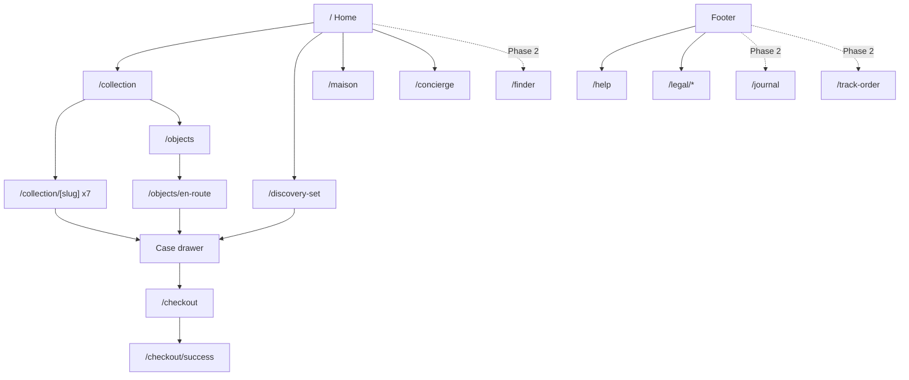

# Ligero Parfum: Site Blueprint

Companion to `ligero/design-system.md` (AUBE light theme, Cormorant Garamond + Schibsted Grotesk). Standard: awards-level. The brief wins over any database default.

All copy in this blueprint follows `ligero/brand-voice/SKILL.md`. When writing or rewriting any string, load that skill first.

## 1. Sitemap

Competitor-informed (Le Labo, Byredo, Bombay Perfumery, Ministry of Scent), trimmed to a nine-product house. A flat header, no mega-menu, and one dedicated entry for the Discovery Set because it is the cold-traffic way in. Depth kills desire.

```
PHASE 1 (ship)
/                          Home. The brand film you can scroll.
/collection                The Collection. All seven perfumes.
/collection/[slug]         Fragrance detail. noctis, aube, maree, ambre-doux, blanc, fleur, noir-cacao.
/discovery-set             The Discovery Set. Seven vials, the way in for new wearers.
/objects                   Objects. A shelf of two: the Discovery Set and En Route.
/objects/en-route          En Route, the car perfume.
/maison                    The Maison. Story, farms, numbers.
/concierge                 Concierge. Questions, private appointments, Grievance Officer.
/help                      Shipping, returns, authenticity, how to wear and store.
/checkout                  Checkout.
/checkout/success          Order confirmation.
/legal/privacy             Privacy Policy.
/legal/terms               Terms of Sale and Use.
/legal/shipping-returns    Shipping and Returns.
/legal/grievance           Grievance Officer.
/404, /sitemap.xml, /robots.txt, social share images

PHASE 2 (when there is something to publish)
/journal, /journal/[slug]  The Journal. Ships with at least three essays, never empty.
/finder                    Three questions, one of the seven.
/track-order               Order tracking.
```



Catalog, client-confirmed: seven perfumes (Noctis, AUBE, Marée, Ambre Doux, Blanc, Fleur, Noir Cacao), plus Objects (the Discovery Set, En Route for the car). The Seven are the whole line; there is no tier or permanence split. Name spelling is client-confirmed as "Noir Cacao"; earlier "Noir Coco" references in this document are superseded.

Copy direction, client-confirmed: lead with feel and emotion, never with inventory counts or collection architecture. Do not build copy around "the Five", "permanent", "Suite", or any permanence framing. Seven is a fact to state quietly where a number is needed ("Seven perfumes"), never a theme.

Provenance, client-confirmed: Handcrafted in small batches with pure botanical extraits. No unauthorized regional provenance claims.

Nav reads: **Collection, Discovery Set, Maison, Concierge.** Four words. Journal sits in the footer until it has three essays. FAQ, shipping, returns and tracking live in the footer, never the nav. Objects is reached from the Collection page band and the footer.

Legal pages exist because applicable statutory law requires them (DPDP Act 2023, Consumer Protection E-commerce Rules, Legal Metrology). Footer only, drafts in `ligero/legal/`: Privacy Policy, Terms of Sale and Use, Shipping and Returns, Grievance Officer. The Grievance Officer block also appears on the Concierge page.

## 2. Global elements

- Header: centered crest, one line, max height 72px. Left: Collection, Discovery Set. Right: Maison, Concierge, Search, Case. Hairline bottom border appears only after scroll. No second nav row, no region selector.
- Collection hover panel: the seven bottle cutouts, name under each, no prices. On touch and keyboard, the same panel opens on tap or Enter.
- Footer: Noctis dark (#101418), unbleached silk text (#EAE6DC), brass accents. Four columns: Explore (Home, The Collection, The Discovery Set, Objects), Maison (The Maison, The Journal when live), Help (Help, Shipping and Returns, Track an order when live, Concierge), The Correspondence. One legal line at the bottom: entity name, registered address, GSTIN, then text links: Privacy Policy, Terms of Sale, Shipping and Returns, Grievance Officer.
- Newsletter: one email field, one promise line: "Four letters a year. Nothing else."
- Case: a drawer, not a page. Holds quantity, an optional gift note, and the route to checkout.
- Scroll: parallax on hero imagery only. Reduced-motion collapses everything to static.
- No custom cursor, no announcement bar, no scroll cues. Luxury does not shout.

## 3. Hero per page

| Page | Hero | Behavior |
|---|---|---|
| / | Asymmetric split | Type left 40%, image right 60%. 4 text elements max. |
| /collection | Type-only | "The Collection" in 6rem Cormorant italic. No image. |
| /collection/[slug] | Product-first | No hero image. Name in 8rem Cormorant italic. Noctis variant dark. |
| /discovery-set | Product-first | Name, price, "Add to Case", flat-lay of the seven vials. |
| /objects | Type-only | "Objects." in 6rem Cormorant italic. |
| /maison | Full-photo | One photo. One line of copy. |
| /concierge | Type-only | "Concierge." One word, set huge. Nothing else. |
| /help | Type-only | "Help." One word. Accordions start directly below. |
| /journal (Phase 2) | Type-only | "The Journal" in 6rem Cormorant italic. |

## 4. Home sections, in order

1. **Hero**. AUBE raw silk. Eyebrow LIGERO PARFUM. Headline in Cormorant 300 at 5rem: "Scent, worn like silk." Subline: "Seven permanent perfumes." CTA text link, hairline underline: "Explore the Collection". No button fill.
2. **The Collection**. Horizontal scroll row of tall-crop product images, name in Cormorant italic below each. No prices, no ratings. Home does the desiring; the collection page does the selling.
3. **The Discovery Set**. Full-bleed photo of the seven vials inside a hairline box. One line, one link: "Open the Discovery Set". This is the cold-traffic way in, so it sits directly after the Collection.
4. **Craft strip**. Three images, 9-word captions, hairline-separated: sourcing, blending, resting.
5. **Editorial break**. Full-width Noctis band, Bodoni Moda 4rem: "Perfume is memory, made wearable."
6. **The Correspondence**. One email field, button "Request the Correspondence".
7. **Footer**.

There is no standalone featured-release banner on Home. A single perfume's campaign belongs on its own page, not in a slot above the fold of the whole house.

Layout families used: split hero, horizontal scroll, full-bleed photo with box, captioned strip, color band, form. Six distinct families, no repetition.

## 5. Home copy

Copy leads with feel and emotion. No permanence framing, no collection-architecture language in user-facing strings.

- Hero eyebrow: LIGERO PARFUM
- Hero headline: "Scent, worn like silk."
- Hero subline: "Seven permanent perfumes."
- Hero CTA: "Explore the Collection"
- The Collection section title: "Seven Olfactive Emotions." Names only. The mystery does the work.
- Discovery Set section: "Every perfume the house makes, ten millilitres each." Link: "Open the Discovery Set".
- Craft captions (9 words each): "Raw materials come from four farms. We can name them." / "Each blend is cold rested before a single bottle is filled." / "Nothing added to preserve. Nothing added to shine."
- Editorial break: "Perfume is memory, made wearable."
- Correspondence label: THE PRIVATE SALON. Button: "Join the Salon."

Hero stack is exactly 4 elements (eyebrow, headline, subline, CTA). One CTA intent on the page: collection. Newsletter CTA is a separate intent (email).

## 6. Collection page (/collection)

1. **Type-only hero**: "The Collection", 6rem Cormorant italic.
2. **The seven perfumes**. Full-width rows, 60/40 split, image side alternating (max 2 zigzags in a row, break with a full-bleed image between rows 2 and 3). Each row: name in 5rem Cormorant italic, one 7-word line, three note words in Schibsted 12px uppercase, price in Schibsted, link "Open Noctis" with hairline underline. One link label pattern, used seven times ("Open AUBE", "Open Marée", and so on). No ratings, no quick-add.
3. **Prices**. Numerals only in display type ("1299" not "₹1299"), with one small line: "Prices in rupees, inclusive of all taxes."
4. **Optional filter row**. Scroll-snap pills above the rows: All, Fresh, Floral, Woody, Amber, Gourmand. Ship it only if the seven rows run past two screens.
5. **The Discovery Set band**. Hairline box: "New to the house? The Discovery Set. Every perfume, ten millilitres each. 999." Link: "Open the Discovery Set".
6. **Objects band**. Hairline box: "Objects. The Discovery Set and En Route, for the drive." Link: "Open Objects".
7. **Bespoke band**. Hairline box: "Private commissions are accepted twice a year. Write to the maison."
8. **The Correspondence**.
9. **Footer**.

Per-fragrance lines (7 words max):
- Noctis: "Smoke, leather, the hour after midnight."
- AUBE: "Warm skin, citrus peel, first light."
- Marée: "Salt, kelp, the sea at dusk."
- Ambre Doux: "Amber, tobacco leaf, a closing door."
- Blanc: "Linen, iris, the pause before speech."

## 7. Fragrance detail (/collection/[slug])

Two columns on desktop. Left (7 of 12): a scrolling gallery of four or five images. Right (5 of 12): a sticky purchase panel. On mobile the gallery is a swipe carousel with a position count, the panel stacks beneath it, and a sticky bottom bar (price and "Add to Case") appears once the panel scrolls away.

**Purchase panel, top to bottom**
1. Name in Cormorant italic, the 7-word line, then "Extrait de Parfum · 50 ml".
2. Price as numerals, with "Inclusive of all taxes."
3. One primary button: "Add to Case". Nothing else competes with it. No quantity stepper (quantity lives in the Case drawer) and no format toggle that turns the page into a different product.
4. One text link under the button: "Try it first: the Discovery Set, 999".
5. One reassurance line: dispatch time, and that sealed bottles can be returned within seven days (per `legal/shipping-returns.md`).
6. Four closed accordions, utility only: **Ingredients** (full list), **Shipping and returns**, **Declarations** (manufacturer or packer, net quantity, MRP, country of origin, customer care, as Legal Metrology requires; wording checked by counsel), **Care** (storage and how to wear).

**Scrolling content, in order**
1. **Product-first hero**: name in 8rem Cormorant italic, notes line below, no image in the hero.
2. **Notes as poem**: three lines, no pyramid jargon. No "top notes" language. Structured top, heart and base data stays in the CMS for search and the Ingredients accordion.
3. **How it wears**: plain-language scales (close to skin to fills a room, morning to midnight, season). Only claims the house can stand behind. No scores, no decimals, no invented hours.
4. **Ritual**: 25 to 40 words on where and when.
5. **The Material**: 30 to 50 words on one hero ingredient, one farm named, one full-bleed photo.
6. **Provenance line**: "Hand-blended in small batches with pure botanical extraits."
7. **Reviews**: see section 11c.
8. **Continue the story**: two related fragrances, name plus one-liner. Not a card grid; two wide rows.
9. **Concierge line**: "Not sure which? Write to us." Links to /concierge.
10. **Footer**.

"Add to Case", never "Add to Cart". One primary CTA per page.

Per-product colour worlds: the gallery backdrop and one accent take the product's palette from `design-system.md` (Noctis, Marée, Ambre Doux, Blanc). Header, footer and type never change. Noctis PDP gets the full Noctis dark treatment (Noctis palette, Bodoni Moda display); the dark page is a deliberate product-story switch with a strong transition in and out. Fleur and Noir Cacao palettes are not yet defined.

Sample copy, Noctis:
- Notes: "Smoked papyrus. Leather. The hour after midnight."
- Ritual: "On pulse points, after dark. Two sprays. Nothing more is needed."
- The Material: "Wild papyrus. Cut by hand, pressed the same day, aged for a year before it meets the blend."
- Provenance: "Hand-blended in small batches with pure botanical extraits."

Sample copy, AUBE:
- Notes: "Bergamot peel. Orange blossom. Warm skin at dawn."
- Ritual: "Morning scent. Wrists, throat, behind the knees. Repeat at noon if the day deserves it."
- The Material: "Bergamot from one grove. Picked in November, pressed before the oils can turn."

Sample copy, Marée:
- Notes: "Sea salt. Kelp absolute. Wet stone."
- Ritual: "Wear it to the coast. Wrists, neck, forearms."
- The Material: "Kelp absolute. Cut at low tide, distilled within the day."

Sample copy, Ambre Doux:
- Notes: "Amber. Tobacco leaf. A closing door."
- Ritual: "An evening fragrance. Nape of the neck, chest, coat collar."
- The Material: "Tobacco leaf cured for a year on a single estate in La Rioja."

Sample copy, Blanc:
- Notes: "Linen. Iris. The pause before speech."
- Ritual: "Wear it when you want to be remembered as calm."
- The Material: "Iris pallida, aged three years before grinding. A note that costs more than gold by weight."

Sample copy, Fleur:
- One-liner: "Jasmine, sambac, the courtyard after rain."
- Notes: "Jasmine sambac. Vetiver. Wet earth at dusk."
- Ritual: "A daylight fragrance. Throat, wrists, the ends of the hair."
- The Material: "Jasmine sambac from Madurai, picked before dawn while the flowers still sleep."
- Price: 1299.

Sample copy, Noir Cacao:
- One-liner: "Coconut, toasted, at the last hour of the party."
- Notes: "Coconut husk. Black vanilla. The last hour of the party."
- Ritual: "An after-dark fragrance. Chest, coat collar, one spray too many."
- The Material: "Coconut husk, toasted slow, folded into a vanilla that never turns sweet."
- Price: 1599.

Sample copy, Objects:
- The Discovery Set, 999: "Every perfume the house makes, ten millilitres each."
- En Route, 499: "For the drive." One line, no poem, no ritual.

## 8. Maison (/maison)

1. **Hero**: one photo, one line: "A maison is a promise kept slowly."
2. **Story**. 150 words, single column, 65ch measure. Founder, year, why the house makes few perfumes and not many. No timeline component.
3. **The four farms**. Four wide rows, one farm each: region, crop, one fact. No logos, no map pin decoration.
4. **Numbers, stated plainly**. Seven bottles. Cold rested maceration. Zero synthetic preservatives. Set as three lines of large Cormorant numerals with 4-word labels. No stat cards.
5. **The atelier photo**. Full-bleed, no caption.
6. **Concierge link**. Text link: "Arrange a private appointment."
7. **Footer**.

## 9. Journal (/journal)

1. **Type-only hero**: "The Journal".
2. **Index**. Five to seven essays. Each row: title in Cormorant italic, one-line standfirst, reading time. No dates, no thumbnails, no categories. Dates make a journal feel expired.
3. **Essay page pattern**: single column, 65ch, Cormorant 20px body, drop cap on first paragraph. No related-posts grid. One closing link: "The Collection."
4. **Footer**.

Sample essay titles: "Why we cold rest a perfume." / "The cost of real iris." / "What the sea does to kelp absolute." / "On wearing perfume for yourself."

## 10. Objects (/objects)

The Discovery Set and En Route live here. Light section, few words. The Discovery Set also has its own page (section 11a), because it is the cold-traffic entry point.

1. **Type-only hero**: "Objects."
2. **The Discovery Set**. One wide row, bottle-lineup photo: "Every perfume the house makes, ten millilitres each. Seven vials, one box. 999." Link: "Open the Discovery Set".
3. **En Route**. One wide row, product photo: "For the drive. 499." One line. Link: "Open En Route" to `/objects/en-route`, a short single-product page: photo, one line, price, "Add to Case", Declarations accordion. No poem, no ritual.
4. **The Correspondence**.
5. **Footer**.

Two rows, no card grid. Objects is a shelf, not a shop.

## 11. Concierge (/concierge)

1. **Type-only hero**: "Concierge."
2. **One promise line**: "Write, and a person answers within a day."
3. **Form**: name, email, message, optional "regarding" select (Private appointment / Private commission / Press). Labels above fields, never placeholder-as-label. Error text below fields. No reCAPTCHA badge visible; use an invisible honeypot.
4. **Alternatives**. Direct email and one phone number, set as text. No chat widget. Luxury is a reply, not a pop-up.
5. **Grievance Officer block**. Required by the DPDP Act and the E-commerce Rules, set as quiet text, not a warning box: name, grievance@ligeroparfums.com, phone, hours, "Acknowledged within 72 hours. Resolved within 30 days." Draft in `legal/compliance-checklist.md`. Also published on `/legal/grievance`.
6. **Footer**.

## 11a. The Discovery Set (/discovery-set)

The cold-traffic entry point. A buyer who cannot smell a website tries seven first.

1. **Product-first hero**: "The Discovery Set", price 999, "Add to Case", flat-lay of the seven vials.
2. **What is inside**: the seven vials as a horizontal strip, name and one line each. Each opens its perfume page.
3. **How to use it**: three steps, one line each. Wear one a day. Note where it settles on your skin. Choose one.
4. **Credit toward a full bottle**: open. The client has not confirmed a credit. Until they do, the set sells as a product and this section is omitted. Never invent a credit mechanic.
5. **The Correspondence**.
6. **Footer**.

## 11b. Help (/help)

Read mode. Grouped accordions, written in the house voice: Shipping, Returns (opened and sealed), Authenticity, How to wear and store, Payments. Same facts as `legal/shipping-returns.md`, shorter. Footer link only.

## 11c. Reviews

Real reviews only. No placeholder ratings, counts or quotes exist anywhere on the site.

- Every perfume page has a "Write a review" button that opens a form: rating, name, city (optional), email (private), title (optional), review, and "Worn for" (optional).
- A review is saved as pending in Sanity (`customerReview`). Nothing shows until someone at the house sets it to approved in the Studio, under Reviews.
- The average and count are computed from approved reviews only. A perfume with no reviews shows "Nothing here yet" and no stars. The rating line in the purchase panel appears only when reviews exist.
- The reviewer's email is never shown and never returned by a site query. A "Purchase checked" mark appears only when the house ticks it after matching the email to an order.
- Collection cards, Home, and the Collection page never show ratings.
- The form needs `SANITY_API_WRITE_TOKEN` (Editor role) in the server environment, and the Sanity revalidate webhook must include `customerReview` with the projection `{_type, perfumeSlug}`.

## 11d. Phase 2 and site hygiene

- **/journal and /journal/[slug]**: the index and essay pattern in section 9. Ships only with at least three essays. Until then it is not in the nav, not in the footer, and not in `sitemap.xml`.
- **/finder**: three questions (when you wear it, what you reach for, how near you want it), one answer, one of the seven. No quiz chrome, no email gate.
- **/track-order**: order lookup by order number and email.
- **Hygiene (Phase 1)**: `404` ("This page does not exist. The Collection does."), `sitemap.xml`, `robots.txt`, `Product` structured data with INR price and availability on every perfume page, and social share images per page.

## 12. Marketing psychology, applied quietly

- Scarcity: small batches, no restocks promised. True scarcity, never a countdown timer. Never framed as permanence or tiering.
- Authority: single-origin estates and artisanal distillation. Facts do the persuading. No unverified geographical claims.
- Mimetic desire: the Collection row. Desire spreads from seeing others' objects of desire. No testimonial wall and no quotes pulled onto marketing pages. Social proof lives only in approved reviews on each perfume page (section 11c).
- Loss aversion in the bespoke band: "twice a year" closes twice, gently.
- Zero-price effect: never discount. No sale language anywhere, ever.
- Reciprocity: the Discovery Set. Trying seven before choosing one removes the fear of a blind buy, which is the main objection to buying perfume online.
- Peak-end rule: the Correspondence is the last section before the footer on every page. Every visit ends with a small gift.

## 13. Copy rules (the impactful-as-few-words system)

- Maximum 12 words per headline. Maximum 25 per paragraph. One idea per section.
- Concrete nouns over adjectives: "kelp absolute" beats "oceanic freshness".
- Fragrance descriptions are weather, time, and place. Never mood boards.
- CTA format: verb + specific thing. "Explore the Collection", "Add to Case", "Request the Correspondence". Never "Learn more", "Discover more", "Shop now".
- Voice: declarative, dry, certain. The brand never persuades; it states.
- Zero em dashes anywhere. Zero exclamation marks. Zero marketing filler: no "elevate", "seamless", "unleash", "timeless elegance", "crafted with passion".
- Numbers as words when under one hundred and not a price: "seven perfumes".

## 14. Anti-slop checklist for this build

- No custom cursor. No scroll cues. No announcement bars.
- No eyebrows above every section: maximum 1 eyebrow per 3 sections (Home uses 2 total).
- No section numbers ("01 / Hero"), no decorative middle dots, no mono-caps strips.
- No 3-equal-card rows anywhere. Layout families alternate per section.
- No testimonial quotes with fake names. Star ratings appear only from real reviews written on the product page and approved by the house. No review means no stars, never a placeholder.
- No emojis, no icon soup; icons only where function demands (form errors, mobile menu).
- Motion: hero parallax and one staggered reveal on the Collection row, both wrapped in prefers-reduced-motion.
- Contrast pairs AA verified by computation (2026-09 audit): espresso on raw silk 13.5:1 · accent `#A64B24` on raw silk 4.94:1 · taupe on raw silk 5.13:1 · silk white on Noctis 14.8:1 · brass `#B9975B` on Noctis 6.7:1. Muted-text opacity floors: full-strength taupe on silk, `/55` on Noctis dark. Cart badge: espresso text on espresso/brass fills, never white-on-brass. Do not revert the accent to `#B0522A` (4.41:1, fails AA at label sizes).
- Header bar uses the nav tints (`#ECE3D3` light / `#151A1F` dark), a half-step deeper than the page so the bar reads as its own layer. All header text passes AA on the tints.
- Images: real product photography only. The repo images folder is the source. No picsum placeholders on production pages.
- Zero em dashes in every visible string, verified by search before ship.

## 15. Price list (client-confirmed, fixed)

| Product | Price |
|---|---|
| The Discovery Set | 999 |
| AUBE | 1099 |
| Blanc | 1099 |
| Fleur | 1299 |
| Noctis | 1299 |
| Noir Cacao | 1599 |
| Ambre Doux | 1699 |
| Marée | 1699 |
| En Route (car) | 499 |

Per bottle. Numerals without currency symbols in display type, per the copy rules. The Discovery Set credit question stays open; the client's answer described the set's contents, not the credit mechanic, so the set currently sells as product, not as a credit funnel.

## 16. Decisions log

| Date | Decision | Source |
|---|---|---|
| 2026-11-10 | Prices are fixed as listed in section 15. Positioning against luxury niche houses is intentional. | Client |
| 2026-11-10 | Statutory entity details retained solely in footer. No extraneous regional claims anywhere. | Client |
| 2026-11-10 | All placeholder ratings, reviews and counts removed. Reviews are real, written on the perfume page, moderated before they appear. | Client |
| 2026-11-10 | Nav is Collection, Discovery Set, Maison, Concierge. Journal moves to the footer until it has three essays. | Client |
| 2026-11-10 | Concierge lives at /concierge, not /contact. | Client |
| 2026-11-10 | The Discovery Set gets its own page. Credit toward a full bottle stays open until the client confirms it. | Open |
| 2026-11-10 | Featured Aubé banner removed from Home. | Client |
